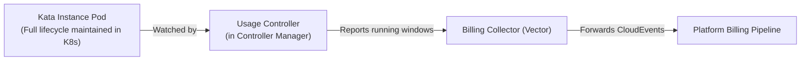
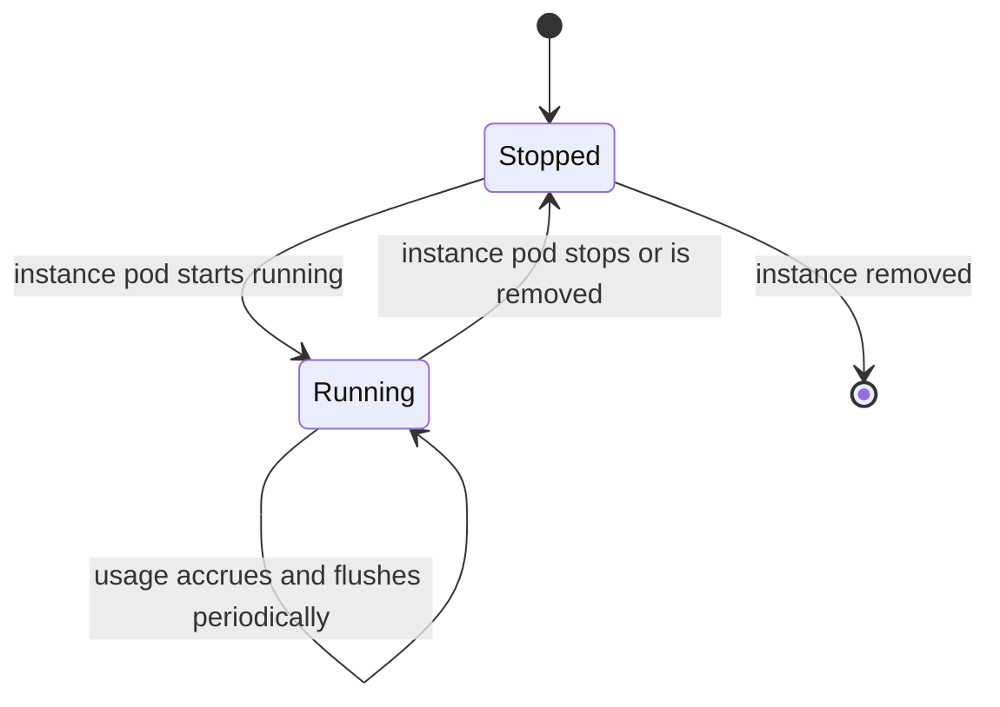

# Usage Metering for the Kata Provider

- [Summary](#summary)
- [Motivation](#motivation)
  - [Goals](#goals)
  - [Non-Goals](#non-goals)
- [Proposal](#proposal)
  - [Where This Fits](#where-this-fits)
  - [User Stories](#user-stories)
  - [How It Works](#how-it-works)
  - [Risks and Mitigations](#risks-and-mitigations)
- [Design Details](#design-details)
  - [A Usage Controller in the Controller Manager](#a-usage-controller-in-the-controller-manager)
  - [The Shipping Step](#the-shipping-step)
- [Technical Details](#technical-details)
- [Drawbacks](#drawbacks)
- [Alternatives](#alternatives)
- [Implementation History](#implementation-history)
- [Infrastructure Needed](#infrastructure-needed)

## Summary

Today, running a general-purpose Kata instance produces no usage data for billing. In Kata, an instance is realized as a Kubernetes pod whose lifecycle reflects the virtual machine's entire lifecycle — from the moment it starts running to the moment it stops or is removed.

Because the entire lifecycle of the pod is maintained in Kubernetes, and because the provider already runs a controller manager, we can measure usage by adding a dedicated **usage controller** to that manager. The controller watches instance pods as they start and stop, attributes their running time and resource size to the project that owns them, and hands the resulting usage records to the platform's billing pipeline.

## Motivation

The Kata provider runs customer workloads in the `general-purpose` runtime class, isolating each instance inside its own lightweight virtual machine. Without usage metering, three things are missing:

1. **No record of what ran.** Quota limits how much capacity a project can reserve at one time, but nothing tracks how long an instance actually ran.
2. **No distinction between running and stopped.** An instance that ran for thirty seconds and one that ran for a month look the same unless something is tracking when each one was actually running.
3. **No runtime tier on the bill.** The general-purpose tier has its own cost profile and price. Usage records need to carry that tier so the billing system can price them appropriately.

Adding this means customers are charged only for the compute and memory their instances actually used, and only for the time those instances were actually running.

### Goals

- Every instance's actual running time is measured accurately and attributed to the right project.
- Stopped, failed, or suspended time is never counted — only time spent running.
- Usage reflects the full instance size the customer requested, even when the cluster overcommits resources on the underlying node.
- Every usage record identifies that it ran in the `general-purpose` tier so billing applies the right rate.
- Measurement survives normal operational hiccups (a controller restart, a leader change, or a network retry) without losing usage or counting the same time twice.
- When an instance's project cannot be identified, that is flagged clearly and loudly rather than silently billing the wrong place.

### Non-Goals

- **Pricing, rate cards, or invoicing.** This produces usage records; the billing platform decides what they cost and generates invoices.
- **Measuring guest CPU or memory utilization.** Billing is based on the instance size allocated to the workload while it runs, not how busy the CPU or memory was inside the virtual machine.
- **Adding a new agent to every node.** Because the full lifecycle of each instance pod is already maintained in the cluster and visible to the controller manager, no per-node daemon is needed.

## Proposal

### Where This Fits

The Kata provider runs a controller manager in the cluster. By registering a usage controller in that manager, we can observe the lifecycle of every Kata instance pod directly from the cluster, determine which project owns it and how much CPU and memory it was sized for, and forward usage windows to the billing collector.

### User Stories

**A short-lived workload is billed fairly.** A customer runs an instance for twenty seconds and deletes it. Only those twenty seconds are measured and billed — not a rounded-up minimum or a fixed polling window.

**Stopped and suspended instances cost nothing.** When an instance is suspended or stopped, its pod stops running. Usage stops accruing immediately and only starts again if and when a pod for that instance is running again.

**Node overcommit does not change what is metered.** Even if the cluster packs nodes tightly by reserving less capacity on the host than the full instance size, the usage record still reflects the actual instance size the workload runs with.

**An operator trusts the numbers.** Whether the controller manager restarts or a report is retried, the usage that lands in the billing pipeline is neither lost nor counted twice.

**A misconfiguration is visible, not silent.** If an instance's project cannot be determined, operators see a clear warning instead of silent data loss or misattributed charges.

### How It Works

For each Kata instance pod, the usage controller watches for the moment it starts running and the moment it stops. While the pod is running, the clock is ticking. When the pod stops — whether because the container exited, the instance was suspended, or the instance was deleted — the clock stops, and the elapsed time (along with the instance's CPU and memory size) is emitted as a usage window attributed to the project. Long-running instances also report incrementally every few minutes so usage shows up continuously without waiting for the pod to stop.

### Risks and Mitigations

- **The controller manager restarts while instances are running.** If the controller only kept track of running time in memory, restarting it would either lose recent usage or recount time that was already reported. Mitigation: whenever the controller reports a usage window, it records a timestamp marker on the pod itself. On restart, it reads that marker and continues from where it left off.
- **An instance is deleted before its final usage is sent.** Mitigation: the pod remains in the cluster until its virtual machine has stopped, and the controller records the final usage window as part of the pod's termination lifecycle.
- **An instance's project cannot be determined.** Mitigation: rather than guessing or using a local cluster namespace name, the controller flags the missing project metadata loudly and drops the unattributable event so no false charges are created.
- **Duplicate reports on retry.** Mitigation: every usage window gets a deterministic ID based on the pod and the time window, so if the same window is sent twice, the billing pipeline deduplicates it automatically.

## Design Details

### A Usage Controller in the Controller Manager

In Kata, there is no separate virtual machine lifecycle hidden outside Kubernetes: one running pod is one running virtual machine, and the entire lifecycle of that pod is maintained by Kubernetes.

Because the provider already runs a controller manager (with shared caches and leader election), we can add a controller dedicated to usage metering inside that same manager. Keeping this work in a controller keeps the architecture clean and decoupled: instance provisioning stays focused on managing workloads, while the usage controller focuses on observing pod lifecycle transitions and emitting usage records — with no extra services to deploy on worker nodes and no privileged access to node filesystems.

### The Shipping Step

Whenever the usage controller flushes a usage window, it hands the record off to **Vector** (the platform's billing collector), which forwards it as standard billing CloudEvents — one for CPU time and one for memory time — to the billing ingestion gateway.

## Technical Details

The usage controller is registered with the provider's controller manager and runs under leader election, sharing the manager's existing Kubernetes cache.

**Tracking Running Windows.** Because the entire lifecycle of a Kata virtual machine is reflected on its pod, each running stretch is tracked by the pod's unique Kubernetes ID. When the controller observes a pod in the running phase with an active container, it opens a usage window anchored at the container's start timestamp. While the pod remains running, the controller flushes open windows on a regular interval (every five minutes by default) and records the last-reported timestamp on the pod. If the controller manager restarts or leadership moves to another replica, the controller reads that timestamp so it only bills the time elapsed since the last flush. When the container exits or the pod terminates, the controller emits the final partial window and closes it.

**Attributing the Project.** On edge clusters, the Kubernetes namespace name itself is a synthetic local identifier created by federation, not the customer's project name. The controller watches cluster namespaces and reads the upstream project identity label stamped on each namespace — the same way the provider's telemetry and metrics rules resolve the project.

**Measuring Instance Size.** To improve node density, clusters can overcommit pod scheduling requests (setting requests lower than limits). However, Kata sizes the virtual machine from the container limits, which hold the true instance size from the instance type catalog. The usage controller always reads the container limits (and ignores helper init containers) so the metered CPU and memory match the instance size the workload was provisioned with.

**Formatting and Shipping Events.** For each time window, two billing events are produced — one for CPU consumption (millicore-seconds) and one for memory consumption (byte-seconds) — tagged with the `general-purpose` runtime class dimension and a deterministic ID derived from the pod ID and window timestamps. These records are handed to Vector (which transforms and forwards them to the billing gateway in production, or to a mock billing gateway in end-to-end tests).

## Drawbacks

- **Periodic metadata updates on running pods.** Saving the last-reported timestamp on each running pod adds one small Kubernetes API update per running instance every flush interval (five minutes).
- **Slight timestamp delay under load.** Start and stop times come from Kubernetes pod status updates, which can trail the exact container exit on the node by a fraction of a second if the node is heavily loaded.

## Alternatives

- **Run a separate metering agent on every node.** A per-node DaemonSet could watch local containers or node files directly. Rejected because the entire lifecycle of the pod is already maintained in Kubernetes and visible to the controller manager, so a per-node agent would add operational overhead and require elevated node permissions without improving accuracy.
- **Use Prometheus / VictoriaMetrics CPU and memory metrics for billing.** The cluster already scrapes container CPU and memory metrics for dashboards and autoscaling. Rejected because those metrics measure fluctuating utilization rather than allocated instance size, and periodic metric scrapes can have gaps and lack per-window deduplication IDs.

## Implementation History

- **Proposed here.** Initial design for a usage controller in the Kata provider's controller manager.

## Infrastructure Needed

- Allow the Kata provider's Kubernetes role to read namespaces so the usage controller can look up the project for each pod.
- Configure the Kata provider deployment to connect to the cluster's Vector billing collector.
- Add an end-to-end test overlay with Vector and a mock billing gateway to verify usage events in CI.
